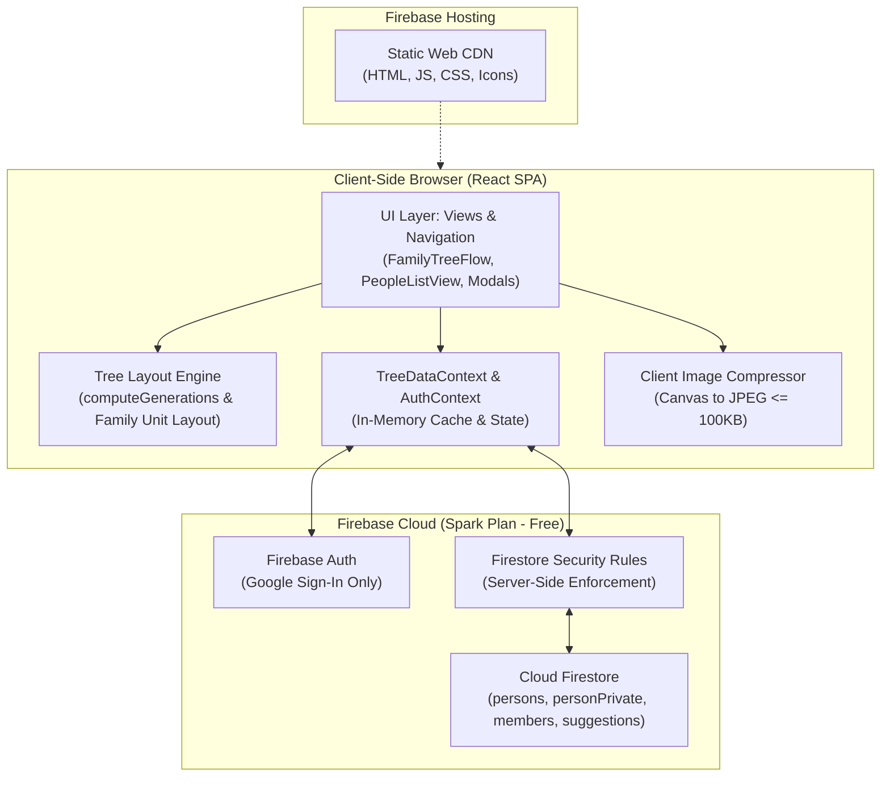
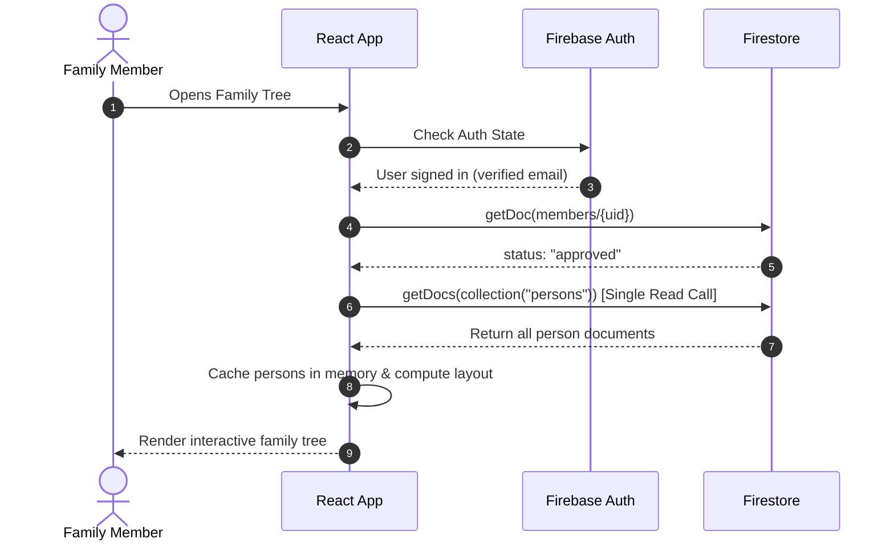
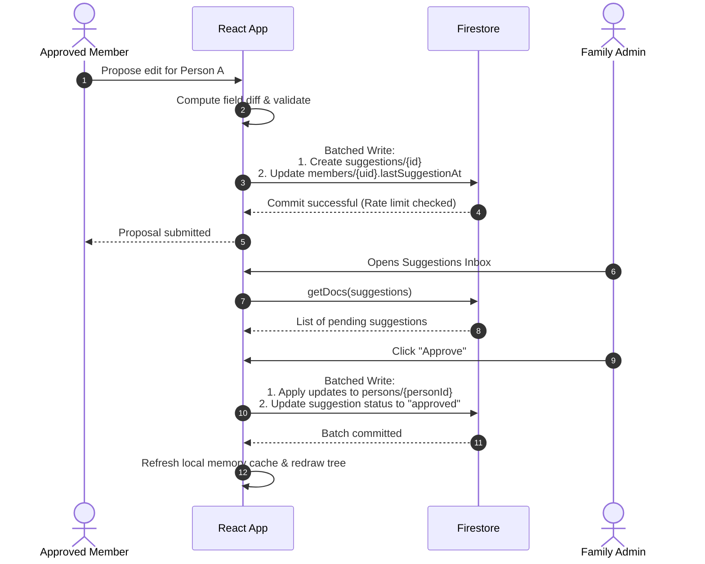

# System Architecture

This document describes the architectural design, component interactions, data flow, and design rationale behind the Rajawat Family Tree web application.

---

## 🏛️ High-Level Overview

The Rajawat Family Tree is a **pure client-side Single Page Application (SPA)** written in React, Vite, and TypeScript. All application business logic, graph layout calculation, relationship processing, and image compression execute directly inside the user's web browser. Cloud operations are restricted entirely to Firestore document reads/writes and Google Authentication via the Firebase Client SDK.

---

## 🧱 Component Breakdown

### 1. UI Layer (`src/components/`)
- **`FamilyTreeFlow.tsx`**: Host container for the React Flow canvas. Manages viewport sizing, search-and-jump queries, view mode toggles (All / Ancestors / Descendants), root person selection, and the "Tree View" vs "People list" switcher.
- **`PersonNode.tsx`**: Custom React Flow card component representing an individual family member. Renders initials or photo thumbnail, full name, nickname, vital status (living indicator vs deceased years), birth place, occupation, collapse branch button, and 4 explicit connection handles (top, bottom, left, right).
- **`UnionNode.tsx`**: Custom React Flow node representing a couple's marriage union. Positioned between spouses, receiving parent connections from the top handle and routing lineage downward to children from the bottom handle.
- **`PeopleListView.tsx`**: Tabular fallback view listing all family members, birth years, and parents, allowing quick selection and administrative editing.
- **`PersonFormModal.tsx`**: Add/edit person modal with client-side form validation, relationship linking (father, mother, spouses), automatic reciprocal linking, and living person confidential data entry (for administrators).
- **`SuggestionsInboxModal.tsx`**: Admin panel for evaluating member submissions with visual side-by-side diffs (current vs proposed values).
- **`MembersModal.tsx`**: Admin panel to approve, block, or remove member accounts.
- **`BackupModal.tsx`**: JSON and GEDCOM export utility, as well as validated JSON backup importer.

### 2. State & Context Layer (`src/context/`)
- **`AuthContext.tsx`**: Tracks Firebase Authentication state, manages Google sign-in/sign-out, queries `members/{uid}` to determine if the account is `pending`, `approved`, or `blocked`, and provides role flags (`isAdmin`, `isApproved`, `isPending`).
- **`TreeDataContext.tsx`**: Central data store for all family records.
  - Fetches the entire `persons` collection **once per session** via a single `getDocs()` call and caches it in memory.
  - Manages atomic batched writes for creating, updating, and deleting persons with cascading relation cleanups.
  - Handles suggestion submission and review workflows.
  - Automatically sanitizes payloads by mapping empty strings and `undefined` properties to `null`.
  - Enforces conditional writes to `personPrivate` so documents are only written when private fields contain values.

### 3. Tree Layout Engine (`src/components/tree/layoutGraph.ts`)
- **Generation Calculator (`computeGenerations`)**:
  - Traverses parent links to assign generation depths: $\text{gen}(child) = \max(\text{gen}(father), \text{gen}(mother)) + 1$.
  - Propagates generation ranks to spouses who married into the family (individuals with no parents recorded), ensuring they match their spouse's generation.
- **Family Unit Layout**:
  - Groups spouses into cohesive family units with a 50px horizontal gap between cards.
  - Inserts union nodes centered between couples.
  - Positions subtrees recursively to prevent node collisions across generations.
  - Generates couple edges (`💍 Couple`) connecting the right handle of the left spouse to the left handle of the right spouse.

---

## 🔄 Data Flow

### A. Initial Load & Caching Flow

### B. Suggestion Submission & Review Flow

---

## 🚫 Architectural Constraints & Design Rationale

The architecture of the Rajawat Family Tree is deliberately constrained to run on the **Firebase Spark plan** at **zero ongoing financial cost**. Here is why specific traditional backend technologies were intentionally avoided:

### 1. No Node.js / Server Backend
- **Constraint**: Running a 24/7 backend container (e.g., Cloud Run, Heroku, AWS EC2) incurs server hosting fees or requires maintenance of cold starts and container images.
- **Solution**: The entire app is deployed as static files to **Firebase Hosting**. Security and access control are offloaded entirely to **Firestore Security Rules**, which run natively inside Google Cloud at zero cost.

### 2. No Firebase Cloud Storage
- **Constraint**: Cloud Storage requires separate bucket provisioning and charges for storage volume and network egress when exceeding small limits.
- **Solution**: Avatars are scaled and compressed directly in the browser via HTML5 Canvas into ultra-compact JPEG thumbnails (under 100 KB, max 200×200 pixels). The resulting Base64 string is stored directly within the `photoThumb` string property in the Firestore person document. This eliminates the need for a storage bucket entirely.

### 3. No Cloud Functions
- **Constraint**: Firebase Cloud Functions requires the **Blaze (pay-as-you-go)** billing plan with a registered credit card, even within free quotas.
- **Solution**: All cascading deletion cleanup, relation linking, diff calculations, and rate-limiting timestamp verifications are performed via client-side atomic batches (`writeBatch`) validated by Firestore security rules.

### 4. No Firebase App Check
- **Constraint**: App Check reCAPTCHA v3 providers can introduce third-party network overhead, false rejections on privacy browsers, and quota administration complexity.
- **Solution**: Authentication is restricted exclusively to Google accounts with verified emails (`request.auth.token.email_verified == true`). Database rules require approved member status before any family records can be queried, rendering automated abuse unviable.

### 5. Single Read Session Caching
- **Constraint**: Firestore charges for document reads on the Spark plan beyond 50,000 reads/day.
- **Solution**: The entire `persons` collection (typically 200–800 records for a 6–7 generation family) is loaded **once per session** using a single `getDocs()` call. Subsequent filtering (All, Ancestors, Descendants, search, branch collapse) is computed in memory with zero additional Firestore reads.
